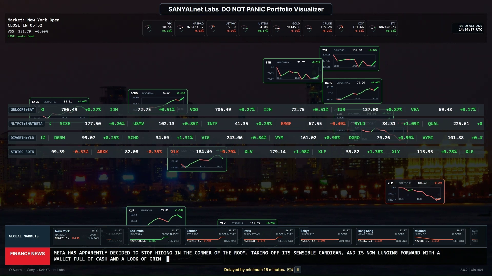

# DO NOT PANIC PORTFOLIO VISUALIZER 2.0

## A desktop dashboard for stocks and world markets

SANYALnet Labs DO NOT PANIC Portfolio Visualizer 2.0 puts ticker tapes, floating price charts, market indicators, global market cards, finance headlines, changing backgrounds, and an AH.FM radio player on one screen. Its six release packages cover Windows, Linux, and macOS, with x64 and ARM64 builds for each.

The dashboard shows market quotes delayed by at least 15 minutes. The warning is on screen for a reason; markets are quite capable of moving while nobody is looking.



Watch the 40-second DNPPV 2.0 product tour:

https://github.com/user-attachments/assets/38e7666a-9c46-4d4e-81cd-e1320f364ea5

## What the dashboard shows

- **Portfolio ticker tapes** scroll the symbols in your configured tapes.
- **Floating price charts** show recent price movement, with green or red outlines and lines.
- **Market indicator dials** show selected market values and changes.
- **Global market cards** show index values and session details for selected cities.
- **Finance headlines** come from configured RSS feeds. Optional summaries can be requested from an API service you configure.
- **Changing backgrounds** use the bundled image collection or a folder you choose.
- **AH.FM radio** includes play and pause controls, plus retries across stream relays.

## Download DNPPV 2.0.2

Choose the ZIP for your operating system and CPU. Each package is self-contained and includes the app's runtime files.

| System | CPU | Download |
| --- | --- | --- |
| Windows | x64 | [Download Windows x64](https://github.com/tuklusan/Do-Not-Panic-Portfolio-Visualizer-Multi-Paltform-2.0/releases/download/v2.0.2/DoNotPanicPortfolioVisualizer-v2.0.2-win-x64.zip) |
| Windows | ARM64 | [Download Windows ARM64](https://github.com/tuklusan/Do-Not-Panic-Portfolio-Visualizer-Multi-Paltform-2.0/releases/download/v2.0.2/DoNotPanicPortfolioVisualizer-v2.0.2-win-arm64.zip) |
| Linux | x64 | [Download Linux x64](https://github.com/tuklusan/Do-Not-Panic-Portfolio-Visualizer-Multi-Paltform-2.0/releases/download/v2.0.2/DoNotPanicPortfolioVisualizer-v2.0.2-linux-x64.zip) |
| Linux | ARM64 | [Download Linux ARM64](https://github.com/tuklusan/Do-Not-Panic-Portfolio-Visualizer-Multi-Paltform-2.0/releases/download/v2.0.2/DoNotPanicPortfolioVisualizer-v2.0.2-linux-arm64.zip) |
| macOS | x64 | [Download macOS x64](https://github.com/tuklusan/Do-Not-Panic-Portfolio-Visualizer-Multi-Paltform-2.0/releases/download/v2.0.2/DoNotPanicPortfolioVisualizer-v2.0.2-osx-x64.zip) |
| macOS | ARM64 | [Download macOS ARM64](https://github.com/tuklusan/Do-Not-Panic-Portfolio-Visualizer-Multi-Paltform-2.0/releases/download/v2.0.2/DoNotPanicPortfolioVisualizer-v2.0.2-osx-arm64.zip) |

All six packages and their SHA-256 checksums are listed on the [v2.0.2 release page](https://github.com/tuklusan/Do-Not-Panic-Portfolio-Visualizer-Multi-Paltform-2.0/releases/tag/v2.0.2). Match both the operating system and CPU before downloading. An ARM build and an x64 build are not interchangeable, however much they may wish to be.

## Install and start

1. Download the ZIP matching your operating system and CPU.
2. Extract the whole ZIP into a folder you can write to.
3. Start `DoNotPanicPortfolioVisualizer.App` from that folder. Windows packages include the `.exe` extension.

The release packages include the .NET runtime, so a separate .NET install is not required to run them. Keep the extracted files together; the visualizer starts its bundled quote-data service as part of the app.

## Configure tapes, backgrounds, news, and radio

Open **Options → Settings** from the app. In **General**, you can add or remove portfolio tapes and symbols, set tape direction and speed, choose a background image folder, and change how often the background changes. The enabled checkboxes decide which tapes and symbols appear.

In **Advanced**, choose RSS headlines or summarized headlines, edit the feed addresses, and set the summary service details. The default feeds are CNBC, MarketWatch, and Investing.com. Summary requests use the API endpoint, model, and key you enter, so network access is needed and the service may charge for its use.

The API key is saved in the local settings file as Base64 text. Base64 is reversible encoding, not encryption. Keep that settings file private, as you would any file containing an API key.

The AH.FM player needs an internet connection and an audio output device. Use its play and pause controls to manage playback.

## Market data, news, and network use

Market quotes are delayed by at least 15 minutes. Values and feeds can be stale or unavailable when a data service or network connection is down. Use a current source for time-sensitive decisions.

The app connects to its bundled quote-data service and to external market, RSS, and radio services. Optional headline summaries also send the selected feed headlines to the summary provider configured in Advanced settings. Check the terms and privacy practices of any provider you choose.

## Build from source

Install Python 3.12 and the .NET 10 SDK, then run:

```sh
python build.py
```

The build script places one self-contained output folder per system and CPU under `dist/`. It keeps compiler output and caches in `build-temp/`, outside the `src/` tree. Network access is needed to restore build dependencies.

## License

This software is available for personal, educational, and hobby use under the [SANYALnet Labs Non-Commercial License](LICENSE). Commercial use requires separate written permission. Read the full license before copying, changing, or sharing the software.

Based on original work by Supratim Sanyal of SANYALnet Labs.

## Help and updates

Use [GitHub Issues](https://github.com/tuklusan/Do-Not-Panic-Portfolio-Visualizer-Multi-Paltform-2.0/issues) to report a problem. Visit [Releases](https://github.com/tuklusan/Do-Not-Panic-Portfolio-Visualizer-Multi-Paltform-2.0/releases) for downloads and updates.
